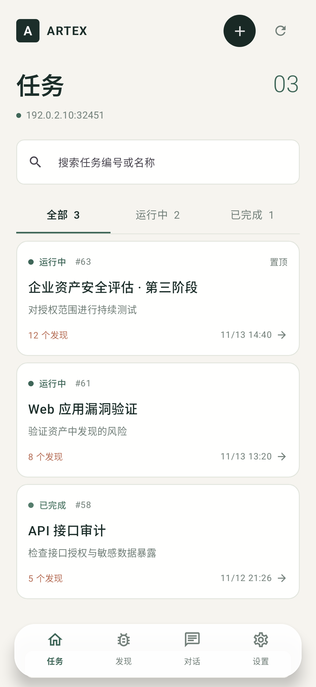

# ARTEX Android

原生 Android 客户端，直接使用现有 ARTEX `/api/*` 接口，服务器无需另装移动端组件。用 Jetpack Compose 构建页面，不嵌入网页。

## 使用

1. 安装 Debug APK，或用 Android Studio 打开本目录运行 `app`。
2. 输入服务器的 `IP:端口` 或完整 `https://域名:端口`，再输入 ARTEX 管理员密码。
3. 底部保留任务、发现、对话、设置四个入口；在「设置 → 完整模式」打开其余管理页面。

任务列表、会话、发现按页面加载。任务的「主对话」支持加载更早记录、切换历史主会话段；可见消息按需读取完整正文，长正文可点按查看。任务的「Agent 状态」显示主 Agent、规划 Agent 和 Worker 的运行状况，Worker 历史按页加载。规划 Agent 暂无独立的实时运行标志，页面显示最近记录和可确认的任务状态。会话支持发送消息、停止执行、选择文件上传附件。任务管理包括新建、暂停、继续、重命名、置顶、归档、删除及归档恢复。任务详情可查看目标、范围、发现、资产、报告、探索、覆盖和审批。完整模式包含仪表盘、流量、工具执行、LLM 记录、资产与同步、工作空间，以及 LLM、Agent、MCP、Skill、工具、通知、拦截、审批、日志和系统配置。自定义背景可从系统相册选择，并可调节遮罩。

完整模式的部分复杂数据（如探索与覆盖）以原生列表呈现；日志为只读查看。桌面网页的某些高级编辑控件仍需在网页端使用。

## 构建

需要 JDK 17、Android SDK 35。运行 `./gradlew :app:assembleDebug :app:testDebugUnitTest`；APK 位于 `app/build/outputs/apk/debug/app-debug.apk`。`preview/` 中的图片由 Compose 预览使用示例数据生成，并非服务器截图。

客户端使用 Bearer token；密码不会保存，token 由 Android Keystore 加密后存于应用私有目录。用户自行输入的 HTTP 地址可以连接；公网连接建议使用 HTTPS，以保护密码和 token 的传输。
